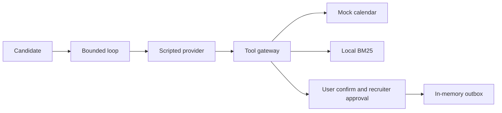

# interview-scheduling-agent

The agent brain in CI is a scripted fake provider; this repo tests the tools, gates, invariants and conversation flow, not model quality. Independent live check on 2026-10-17, grok-4.20-0309-non-reasoning, `booking_end_to_end` on main after the approved-send change, one model. First sample n=5: 5/5 PASS with a simulated approval (outbox=1, `origin=approval`, same `param_hash`), about US$0.11. Three more runs the same day: PASS 3/3, US$0.054. Together that was 8/8. External verification the same day (VERIFY_REPORT_9, HEAD `4c2170d`, Python 3.12.15, cost = `usage.cost_in_usd_ticks`) added 3 runs: PASS 3/3, exit 0, `expect_failures: none`, pending hash = executed hash `f69ebd9b` (`origin: approval`), outbox `out-0004`. Costs US$0.02512, US$0.02060 and US$0.02156, sum US$0.06728 (28 calls, 0 errors; 30–36k tokens in, 612–779 out per run). That was 11/11 PASS with a simulated approval (those 8 plus these 3). External verification of the verb expansion (VERIFY_REPORT_10, HEAD `bb314c9`, PR #12, Python 3.12.15, same model, cost = `usage.cost_in_usd_ticks`) added 3 runs: PASS 3/3, exit 0, `expect_failures: none`, same hash `f69ebd9b` (`origin: approval`), outbox `out-0004`. Costs US$0.01766, US$0.02300 and US$0.01312, sum US$0.05378 (27 calls, 0 errors; about 31k tokens in, 625–714 out per run). Cumulative 14/14 PASS with a simulated approval (those 11 plus these 3). One model, a small sample, not a rate. The report's combined spend is US$0.06837 and includes other repos; this repo's slice of that check is US$0.05378. It does not prove the model retries the tool: the runtime executes the approved call. Per-run splits and token counts for the earlier 8 were not recorded. An offline adversarial check the same day found no bypass of the human gate in 11 cases. In production the recruiter approval has to arrive on an authenticated channel. This repo does not implement that channel; the approval here is simulated. PASS still requires `task_completed=true`: the booking, an invite in the outbox, the approval, and clean invariants. Earlier the same day, before that runtime change, a different n=8: 0/8 PASS, 8/8 INCOMPLETE, 0 FAIL, 0 false positives of `no_cross_candidate_access`, outbox=0, about US$0.15.

An earlier sample the same day, same scenario, n=6, did book and had 3 INCOMPLETE without `send_invite_email` plus 3 FAIL from the cross-candidate false positive (about US$0.07 total). That false positive is fixed; the n=8 sample shows 0 of those FAILs. `happy_path` the same day was INCOMPLETE 3/3 with 0 bookings (US$0.02591).

An earlier check the same day, `happy_path`, 3 runs: INCOMPLETE 3/3, exit 3, 0 bookings. The scenario ended on the first "Sí, confirmo.", so `book_slot` never ran. Cost US$0.00875 + US$0.00872 + US$0.00844 = US$0.02591, 4 calls each. Token counts were not recorded.

A fake provider talking to a fake calendar only shows that the harness runs.

## Problem and result

Taller Aurora, a fictional hiring co-op, books interviews on a mock calendar. A slot is not booked until the candidate confirms that exact slot, and an email stays in an in-memory outbox until a recruiter approves that exact call.

On 2026-10-17, package `scheduling_agent` 0.1.0, commit `b684187e418dc0bd230117841ff8f6b4a6559fd2`, the command `python3 -m scheduling_agent eval` passed **25/25** scenarios with **0** invariant violations.

## Demo

```bash
python3 -m scheduling_agent demo
```

Prints a scripted transcript: up to three slots, a restatement with date, weekday, time and zone, and the recruiter approval before the outbox row. No network call.

## Business case

[EST] About 40 candidates a month, ~25 minutes of recruiter email ping-pong each, versus ~4 minutes to review a slot the candidate already confirmed: about 14 recruiter-hours a month. Formula: [docs/BUSINESS_CASE.md](docs/BUSINESS_CASE.md).

## Architecture



## Results

Measured 2026-10-17, `scheduling_agent` 0.1.0, commit `cc5c233ea771e218f4bb2f28c2df503889db0917`, Python 3.12.3, from the repo root, with `LIVE_LLM=1` and a fake key exported to confirm the suite does not call a provider. CI runs the same commands on Python 3.11 and 3.12. A later commit that only edits docs does not change these counts; re-run the commands to confirm.

| Check | Result | Command |
| --- | --- | --- |
| Eval gate | 26/26 pass, 12 invariants, 0 violations | `python3 -m scheduling_agent eval` |
| Forced regression | exit 1, 54 violations | `python3 -m scheduling_agent eval --regression` |
| Tests | 122 passed, coverage 90.79% | `python3 -m pytest` |
| Lint | ruff check and format check passed | `python3 -m ruff check .` |
| Types | mypy, 25 files, no issues | `python3 -m mypy src` |
| Secret scan | no findings | `python3 -m scheduling_agent.secretscan` |

`no_send_claim_without_outbox` is the twelfth invariant. On the regression it passed 25 scenarios and failed 1 (`kill_switch`, two claim lines, outbox empty). That is why the violation count is 54: 25 approval, 2 send-claim, 26 confirmation, 1 safe-state. Simulated users on that run: mean turns to booking 2.25, mean clarifications per booking 0.00, clarify messages 2, handoff rate 0.08 (2 of 26). The previous measurement, commit `a9b21e5388fafdaaf0b4fa3dd5f5c440ecaf9948`, was 120 passed, coverage 90.77%, with the same eval and regression counts. Commit `bcfd136d8dbbbcdcb9597e96601eee8563c7d620` was 118 passed, coverage 90.65%. Commit `9b11c77fea78a8ee2d31864a0fb6e729e1ee8453` was 116 passed, coverage 90.68%. Commit `afc5f6d96fe99e70bb5d677e3d2b75e5489b5550` was 114 passed, coverage 90.60%.

Re-measured 2026-10-17, same package and Python, commit `f94f39c63951ddddbdfc2992ef0e0f375160c034`, after the live tool-error tests. `python3 -m pytest` : 93 passed, coverage 90.85%. `python3 -m scheduling_agent eval`: 25/25, 0 violations. `python3 -m scheduling_agent eval --regression`: exit 1, 50 violations. `python3 -m ruff check .`, `python3 -m ruff format --check .`, and `python3 -m mypy` passed. Secret scan: no findings.

Re-measured 2026-10-17, same package and Python, commit `b9c04708ea72816ebd63cb37f8c7b3b0f2f71408`, after adding `booking_end_to_end`. `python3 -m pytest`: 103 passed, coverage 91.04%. `python3 -m scheduling_agent eval`: 26/26, 0 violations. `python3 -m scheduling_agent eval --regression`: exit 1, 52 violations. `python3 -m ruff check .`, `python3 -m ruff format --check .`, and `python3 -m mypy` passed. Secret scan: no findings. Simulated users on that run: mean turns to booking 2.25, mean clarifications per booking 0.00, clarify messages 2, handoff rate 0.08 (2 of 26).

Re-measured 2026-10-17, same package and Python, commit `87eb459a88846f58b85cf0f93520afb1fbae4d52`, after the invite turn and the cross-candidate fix. `python3 -m pytest`: 108 passed, coverage 91.07%. `python3 -m scheduling_agent eval`: 26/26, 0 violations. `python3 -m scheduling_agent eval --regression`: exit 1, 52 violations. `python3 -m ruff check .`, `python3 -m ruff format --check .`, and `python3 -m mypy` passed. Secret scan: no findings.

Earlier the same day, commit `b684187e418dc0bd230117841ff8f6b4a6559fd2`: eval 25/25, 11 invariants, 0 violations; regression exit 1, 50 violations; `python3 -m pytest` 86 passed, coverage 90.37%. Simulated users on that 25-scenario measurement (not people): mean turns to booking 2.27, mean clarifications per booking 0.00, clarify messages 2, handoff rate 0.08 (2 of 25). Clarifications are counted only on runs that book, and the clarify purpose is used on runs that do not book.

Retrieval, 30 queries whose labels were written together with the corpus: hit@1 30/30, hit@3 30/30. The bootstrap 95% interval is [1.000, 1.000] because every item is a hit. Resampling this list is not a model comparison and is not evidence of generalization.

## Use cases, governance and business strategy

### Client-style use cases (fictional/anonymized, inspired by a pattern, no real client)

| Use case | Status | Problem | Who approves | Gated effects | How this repo handles it |
| --- | --- | --- | --- | --- | --- |
| Interview scheduling for a small hiring team | Implemented as mock | Slot ping-pong and a wrong invite | Recruiter, after the candidate confirms the slot | `book_slot`; invite, reschedule, and cancel emails | Mock calendar, two gates, in-memory outbox |
| Appointment booking for a clinic-style service | Design only | The same hold-and-confirm pattern, different nouns | A clinician or front desk | Book and patient notice | Not built. Same gates would apply |
| Internal meeting-room or equipment booking | Design only | Shared resource, double booking | The resource owner | Book and a notice to the requester | Not built |

### Personal use cases

| Use case | Status | Problem | Who approves | Gated effects | How this repo handles it |
| --- | --- | --- | --- | --- | --- |
| Personal assistant that never sends without an OK | Design only | A draft leaves before the owner reads it | The owner | Any external send | The recruiter gate is the same shape. Not built for a personal calendar |
| Study-session planner | Design only | Finding a free block with a partner | The person whose calendar it is | A calendar write and a message | Not built |

### Governance checklist

| Control | Where |
| --- | --- |
| Human approval before an external tool | `src/scheduling_agent/approvals.py`, `src/scheduling_agent/tools.py` |
| Approval bound to a hash, then expiry | `src/scheduling_agent/approvals.py` |
| User confirmation of the same slot | `src/scheduling_agent/tools.py`, `src/scheduling_agent/agent.py` |
| Trace and JSON logs | `src/scheduling_agent/trace.py`, `src/scheduling_agent/logging_setup.py` |
| Outbox instead of a real send | `src/scheduling_agent/runtime.py` |
| Kill switch `EXTERNAL_TOOLS_ENABLED=0` | `src/scheduling_agent/tools.py` |
| Risks | [docs/RISKS.md](docs/RISKS.md) |
| Costs | [docs/COST.md](docs/COST.md) |
| Incident, recall, rollback | [docs/RUNBOOK.md](docs/RUNBOOK.md) |

Not covered yet: candidate authentication, a real calendar or mailbox, embeddings, WhatsApp or voice, accessibility testing with people, load testing.

### Business strategy

The business problem is recruiter time spent on slot ping-pong, and the cost of a wrong invite. The ROI model is [EST] in [docs/BUSINESS_CASE.md](docs/BUSINESS_CASE.md). Phased rollout is in [docs/SCOPE.md](docs/SCOPE.md). Success metrics are in [docs/METRICS.md](docs/METRICS.md).

Deployment Strategist conversation: start with discovery ([docs/DISCOVERY.md](docs/DISCOVERY.md)), then a shadow period where a person still sends every message, then turn on the gate against a mock, and only then talk about a real calendar. The recruiter owns the invite. The operator owns the kill switch, the spend cap, and the ledger. The candidate owns the yes on the slot.

## Decisions

- [0001 Scripted provider in CI](docs/adr/0001-scripted-provider-in-ci.md)
- [0002 Invariants, not exact trajectories](docs/adr/0002-invariants-not-trajectories.md)
- [0003 Two confirmations](docs/adr/0003-two-confirmations.md)
- [0004 Local BM25](docs/adr/0004-local-bm25.md)
- [0005 Effect classes, kill switch, and cancel](docs/adr/0005-effect-classes-and-kill-switch.md)
- [0006 Reject naive datetimes](docs/adr/0006-reject-naive-datetimes.md)
- [0007 Pending slot and zoned times](docs/adr/0007-pending-slot-and-zoned-times.md)

## Security and known limits

### What this does NOT do

- A live PASS on 2026-10-17, `booking_end_to_end`, one model: n=5 at about US$0.11 plus 3 more runs at US$0.054 was 8/8. External verification the same day (VERIFY_REPORT_9, HEAD `4c2170d`, `usage.cost_in_usd_ticks`) added PASS 3/3 at US$0.02512 + US$0.02060 + US$0.02156 = US$0.06728 (28 calls). That was 11/11. VERIFY_REPORT_10 on HEAD `bb314c9` added PASS 3/3 at US$0.01766 + US$0.02300 + US$0.01312 = US$0.05378 (27 calls, `usage.cost_in_usd_ticks`). Cumulative 14/14 PASS with a simulated approval. Small sample, not a rate. That does not prove the model retries the tool, because the runtime executes the approved call. The report's combined spend is US$0.06837 and includes other repos. In production the approval has to arrive on an authenticated channel. This repo does not implement that channel. `no_cross_candidate_access` still misses an obfuscated address, an address with spaces, and a first name alone. An offline check that day detected 6/6 direct leaks and passed 3 clean controls (small n). VERIFY_REPORT_9, before the verb expansion, scored fresh forms at recall 15/20 and false positives 1/20 (n=20, a different list). VERIFY_REPORT_10 scored a new set on HEAD `bb314c9`, before this word-boundary fix: recall 15/20, false positives 1/20, n=20, small, not conclusive (about ±19 points). After a real send, 0/20 of that new set were flagged. The two 15/20 figures are not comparable. Recall after this fix: not measured yet.
- The test suite clears `LIVE_LLM`, `LLM_*`, `XAI_API_KEY`, and `MAX_LIVE_SPEND_USD`, and a socket guard fails the run if a test opens a connection. Demo and eval stay on the scripted provider.
- It does not write a Google or Microsoft calendar, and it does not send email.
- It does not authenticate the person in the session.
- It does not prove accessibility, load, or production latency.

### Design-only vs implemented

| Capability | Status |
| --- | --- |
| Mock calendar, holds with TTL, buffers, zones | Implemented |
| Two human gates and parameter-hash binding | Implemented |
| External tools writing only to an in-memory outbox | Implemented |
| Kill switch | Implemented |
| Local BM25 over a synthetic FAQ | Implemented |
| Invariant gate and forced regression | Implemented |
| Optional live adapter, off by default | 2026-10-17, grok-4.20-0309-non-reasoning, `booking_end_to_end`, one model: 11/11 PASS, then VERIFY_REPORT_10 on HEAD `bb314c9` added PASS 3/3 at US$0.05378 (`usage.cost_in_usd_ticks`). Cumulative 14/14 PASS with a simulated approval. Small sample, not a rate. Does not prove the model retries the tool: the runtime executes the approved call. Production approval has to use an authenticated channel; this repo does not implement it |
| Google or Microsoft calendar and email | Design only |
| ATS integration | Design only |
| Candidate authentication | Design only |
| Embeddings or a vector index | Design only |
| WhatsApp or voice | Design only |
| Accessibility testing with people | Design only |
| Load testing | Design only |

Dockerfile provided, not built in CI. Docker was not available when this revision was prepared.

## How to reproduce

Default cost: zero. No API key. Tests do not use the network.

| Make | Plain command |
| --- | --- |
| `make setup` | `python3 -m pip install -e ".[dev]"` |
| `make lint` | `python3 -m ruff check .` and `python3 -m ruff format --check .` |
| `make format` | `python3 -m ruff format .` and `python3 -m ruff check --fix .` |
| `make test` | `python3 -m pytest` |
| `make eval` | `python3 -m scheduling_agent eval` |
| `make eval-regression` | `python3 -m scheduling_agent eval --regression` |
| `make secretscan` | `python3 -m scheduling_agent.secretscan` |
| `make demo` | `python3 -m scheduling_agent demo` |
| `make live` | `python3 -m scheduling_agent live --scenario booking_end_to_end --max-turns 12` |

`make eval-regression` is expected to exit 1. That exit code is the check.

## Next steps

- A larger live sample than the 14/14 simulated-approval PASS, and the send-claim recall after this word-boundary fix, are not measured yet ([docs/LIVE_RUN_TEMPLATE.md](docs/LIVE_RUN_TEMPLATE.md)). VERIFY_REPORT_10, a new set on HEAD `bb314c9` before that fix, is recall 15/20 and 1/20 false positives (n=20, small, not conclusive). VERIFY_REPORT_9's 15/20 is an earlier, different list. Production still needs an authenticated recruiter channel, which this repo does not implement.
- Keep retrieval labels written apart from the documents before claiming anything about generalization.
- Shadow a real calendar only after discovery, with the same gates and the kill switch still in the operator's hands.

## Docs

[HOW_IT_WORKS](docs/HOW_IT_WORKS.md) · [BUSINESS_CASE](docs/BUSINESS_CASE.md) · [DISCOVERY](docs/DISCOVERY.md) · [SCOPE](docs/SCOPE.md) · [RISKS](docs/RISKS.md) · [METRICS](docs/METRICS.md) · [COST](docs/COST.md) · [RUNBOOK](docs/RUNBOOK.md) · [architecture](docs/architecture.md) · [UX_PRINCIPLES](docs/UX_PRINCIPLES.md) · [ADAPT_TO_A_REAL_CLIENT](docs/ADAPT_TO_A_REAL_CLIENT.md) · [LIVE_RUN_TEMPLATE](docs/LIVE_RUN_TEMPLATE.md) · [PROVENANCE](docs/PROVENANCE.md)
