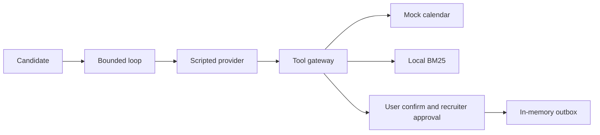

# interview-scheduling-agent

The agent brain in CI is a scripted fake provider; this repo tests the tools, gates, invariants and conversation flow, not model quality. Independent live check on 2026-10-17, grok-4.20-0309-non-reasoning, `booking_end_to_end` on main, n=6 (a small sample, not a rate): 6/6 reached `book_slot` and scheduled, booking id `book-0002`. 3/6 were INCOMPLETE because the model never called `send_invite_email` and asked whether to send; the script ended there. 3/6 FAILed on a false positive in `no_cross_candidate_access`: the trace redacts every address to `[email]`, and the other candidates' addresses were redacted too, so naming the session candidate's own address matched. Total cost about US$0.07. Per-run amounts and token counts were not recorded. None of the six was a legitimate PASS. The recruiter step in `booking_end_to_end` is a simulated approval written into the scenario. PASS still requires `task_completed=true`: the booking, an invite in the outbox, that approval, and clean invariants. A PASS on a real model after the email turn is not measured yet.

An earlier check the same day, `happy_path`, 3 runs: INCOMPLETE 3/3, exit 3, 0 bookings. The scenario ended on the first "Sí, confirmo.", so `book_slot` never ran. Cost US$0.00875 + US$0.00872 + US$0.00844 = US$0.02591, 4 calls each. Token counts were not recorded.

A fake provider talking to a fake calendar only shows that the harness runs.

## Problem and result

Taller Aurora, a fictional hiring co-op, books interviews on a mock calendar. A slot is not booked until the candidate confirms that exact slot, and an email stays in an in-memory outbox until a recruiter approves that exact call.

On 2026-10-17, package `scheduling_agent` 0.1.0, commit `b684187e418dc0bd230117841ff8f6b4a6559fd2`, the command `python3 -m scheduling_agent eval` passed **25/25** scenarios with **0** invariant violations.

## Demo

```bash
python3 -m scheduling_agent demo
```

Prints a scripted transcript: up to three slots, a restatement with date, weekday, time and zone, and the recruiter approval before the outbox row. No network call.

## Business case

[EST] About 40 candidates a month, ~25 minutes of recruiter email ping-pong each, versus ~4 minutes to review a slot the candidate already confirmed: about 14 recruiter-hours a month. Formula: [docs/BUSINESS_CASE.md](docs/BUSINESS_CASE.md).

## Architecture



## Results

Measured 2026-10-17, `scheduling_agent` 0.1.0, commit `b684187e418dc0bd230117841ff8f6b4a6559fd2`, Python 3.12.3, from the repo root. CI runs the same commands on Python 3.11 and 3.12. A later commit that only edits docs does not change these counts; re-run the commands to confirm.

| Check | Result | Command |
| --- | --- | --- |
| Eval gate | 25/25 pass, 11 invariants, 0 violations | `python3 -m scheduling_agent eval` |
| Forced regression | exit 1, 50 violations | `python3 -m scheduling_agent eval --regression` |
| Tests | 86 passed, coverage 90.37% | `python3 -m pytest` |
| Lint | ruff check and format check passed | `python3 -m ruff check .` |
| Types | mypy, 25 files, no issues | `python3 -m mypy src` |
| Secret scan | no findings | `python3 -m scheduling_agent.secretscan` |

Re-measured 2026-10-17, same package and Python, commit `f94f39c63951ddddbdfc2992ef0e0f375160c034`, after the live tool-error tests. `python3 -m pytest` : 93 passed, coverage 90.85%. `python3 -m scheduling_agent eval`: 25/25, 0 violations. `python3 -m scheduling_agent eval --regression`: exit 1, 50 violations. `python3 -m ruff check .`, `python3 -m ruff format --check .`, and `python3 -m mypy` passed. Secret scan: no findings.

Re-measured 2026-10-17, same package and Python, commit `b9c04708ea72816ebd63cb37f8c7b3b0f2f71408`, after adding `booking_end_to_end`. `python3 -m pytest`: 103 passed, coverage 91.04%. `python3 -m scheduling_agent eval`: 26/26, 0 violations. `python3 -m scheduling_agent eval --regression`: exit 1, 52 violations. `python3 -m ruff check .`, `python3 -m ruff format --check .`, and `python3 -m mypy` passed. Secret scan: no findings. Simulated users on that run: mean turns to booking 2.25, mean clarifications per booking 0.00, clarify messages 2, handoff rate 0.08 (2 of 26).

Re-measured 2026-10-17, same package and Python, commit `87eb459a88846f58b85cf0f93520afb1fbae4d52`, after the invite turn and the cross-candidate fix. `python3 -m pytest`: 108 passed, coverage 91.07%. `python3 -m scheduling_agent eval`: 26/26, 0 violations. `python3 -m scheduling_agent eval --regression`: exit 1, 52 violations. `python3 -m ruff check .`, `python3 -m ruff format --check .`, and `python3 -m mypy` passed. Secret scan: no findings.

Simulated users on the 25-scenario measurement above (not people): mean turns to booking 2.27, mean clarifications per booking 0.00, clarify messages 2, handoff rate 0.08 (2 of 25). Clarifications are counted only on runs that book, and the clarify purpose is used on runs that do not book.

Retrieval, 30 queries whose labels were written together with the corpus: hit@1 30/30, hit@3 30/30. The bootstrap 95% interval is [1.000, 1.000] because every item is a hit. Resampling this list is not a model comparison and is not evidence of generalization.

## Use cases, governance and business strategy

### Client-style use cases (fictional/anonymized, inspired by a pattern, no real client)

| Use case | Status | Problem | Who approves | Gated effects | How this repo handles it |
| --- | --- | --- | --- | --- | --- |
| Interview scheduling for a small hiring team | Implemented as mock | Slot ping-pong and a wrong invite | Recruiter, after the candidate confirms the slot | `book_slot`; invite, reschedule, and cancel emails | Mock calendar, two gates, in-memory outbox |
| Appointment booking for a clinic-style service | Design only | The same hold-and-confirm pattern, different nouns | A clinician or front desk | Book and patient notice | Not built. Same gates would apply |
| Internal meeting-room or equipment booking | Design only | Shared resource, double booking | The resource owner | Book and a notice to the requester | Not built |

### Personal use cases

| Use case | Status | Problem | Who approves | Gated effects | How this repo handles it |
| --- | --- | --- | --- | --- | --- |
| Personal assistant that never sends without an OK | Design only | A draft leaves before the owner reads it | The owner | Any external send | The recruiter gate is the same shape. Not built for a personal calendar |
| Study-session planner | Design only | Finding a free block with a partner | The person whose calendar it is | A calendar write and a message | Not built |

### Governance checklist

| Control | Where |
| --- | --- |
| Human approval before an external tool | `src/scheduling_agent/approvals.py`, `src/scheduling_agent/tools.py` |
| Approval bound to a hash, then expiry | `src/scheduling_agent/approvals.py` |
| User confirmation of the same slot | `src/scheduling_agent/tools.py`, `src/scheduling_agent/agent.py` |
| Trace and JSON logs | `src/scheduling_agent/trace.py`, `src/scheduling_agent/logging_setup.py` |
| Outbox instead of a real send | `src/scheduling_agent/runtime.py` |
| Kill switch `EXTERNAL_TOOLS_ENABLED=0` | `src/scheduling_agent/tools.py` |
| Risks | [docs/RISKS.md](docs/RISKS.md) |
| Costs | [docs/COST.md](docs/COST.md) |
| Incident, recall, rollback | [docs/RUNBOOK.md](docs/RUNBOOK.md) |

Not covered yet: candidate authentication, a real calendar or mailbox, embeddings, WhatsApp or voice, accessibility testing with people, load testing.

### Business strategy

The business problem is recruiter time spent on slot ping-pong, and the cost of a wrong invite. The ROI model is [EST] in [docs/BUSINESS_CASE.md](docs/BUSINESS_CASE.md). Phased rollout is in [docs/SCOPE.md](docs/SCOPE.md). Success metrics are in [docs/METRICS.md](docs/METRICS.md).

Deployment Strategist conversation: start with discovery ([docs/DISCOVERY.md](docs/DISCOVERY.md)), then a shadow period where a person still sends every message, then turn on the gate against a mock, and only then talk about a real calendar. The recruiter owns the invite. The operator owns the kill switch, the spend cap, and the ledger. The candidate owns the yes on the slot.

## Decisions

- [0001 Scripted provider in CI](docs/adr/0001-scripted-provider-in-ci.md)
- [0002 Invariants, not exact trajectories](docs/adr/0002-invariants-not-trajectories.md)
- [0003 Two confirmations](docs/adr/0003-two-confirmations.md)
- [0004 Local BM25](docs/adr/0004-local-bm25.md)
- [0005 Effect classes, kill switch, and cancel](docs/adr/0005-effect-classes-and-kill-switch.md)
- [0006 Reject naive datetimes](docs/adr/0006-reject-naive-datetimes.md)
- [0007 Pending slot and zoned times](docs/adr/0007-pending-slot-and-zoned-times.md)

## Security and known limits

### What this does NOT do

- It does not yet score a legitimate live PASS. The 2026-10-17 `booking_end_to_end` sample (n=6) scheduled 6/6 and still had no PASS: 3 INCOMPLETE without `send_invite_email`, 3 FAIL from the `no_cross_candidate_access` false positive. That false positive is fixed in this tree. A real-model re-run is not measured yet. The earlier `happy_path` check the same day was INCOMPLETE 3/3 with 0 bookings.
- It does not write a Google or Microsoft calendar, and it does not send email.
- It does not authenticate the person in the session.
- It does not prove accessibility, load, or production latency.

### Design-only vs implemented

| Capability | Status |
| --- | --- |
| Mock calendar, holds with TTL, buffers, zones | Implemented |
| Two human gates and parameter-hash binding | Implemented |
| External tools writing only to an in-memory outbox | Implemented |
| Kill switch | Implemented |
| Local BM25 over a synthetic FAQ | Implemented |
| Invariant gate and forced regression | Implemented |
| Optional live adapter, off by default | Verificación independiente 2026-10-17, grok-4.20-0309-non-reasoning, `booking_end_to_end` en main, n=6: 6/6 llegan a `book_slot` y agendan (`book-0002`). INCOMPLETE 3/6 porque no hubo `send_invite_email`. FAIL 3/6 por un falso positivo de `no_cross_candidate_access`, corregido en este árbol. Costo total ~US$0.07; el reparto por corrida y los tokens no quedaron registrados. Muestra chica, sin tasa. Ningún PASS. La aprobación del recruiter dentro del escenario es simulada. Un PASS en vivo posterior no está medido. La corrida anterior de `happy_path` (3, INCOMPLETE, 0 bookings, US$0.02591) queda como historia |
| Google or Microsoft calendar and email | Design only |
| ATS integration | Design only |
| Candidate authentication | Design only |
| Embeddings or a vector index | Design only |
| WhatsApp or voice | Design only |
| Accessibility testing with people | Design only |
| Load testing | Design only |

Dockerfile provided, not built in CI. Docker was not available when this revision was prepared.

## How to reproduce

Default cost: zero. No API key. Tests do not use the network.

| Make | Plain command |
| --- | --- |
| `make setup` | `python3 -m pip install -e ".[dev]"` |
| `make lint` | `python3 -m ruff check .` and `python3 -m ruff format --check .` |
| `make format` | `python3 -m ruff format .` and `python3 -m ruff check --fix .` |
| `make test` | `python3 -m pytest` |
| `make eval` | `python3 -m scheduling_agent eval` |
| `make eval-regression` | `python3 -m scheduling_agent eval --regression` |
| `make secretscan` | `python3 -m scheduling_agent.secretscan` |
| `make demo` | `python3 -m scheduling_agent demo` |
| `make live` | `python3 -m scheduling_agent live --scenario booking_end_to_end --max-turns 12` |

`make eval-regression` is expected to exit 1. That exit code is the check.

## Next steps

- Re-run live on `booking_end_to_end` after the "Sí, enviá el email." turn ([docs/LIVE_RUN_TEMPLATE.md](docs/LIVE_RUN_TEMPLATE.md)). PASS needs the booking, the invite in the outbox, the simulated recruiter approval, and clean invariants. That re-run is not measured yet.
- Keep retrieval labels written apart from the documents before claiming anything about generalization.
- Shadow a real calendar only after discovery, with the same gates and the kill switch still in the operator's hands.

## Docs

[HOW_IT_WORKS](docs/HOW_IT_WORKS.md) · [BUSINESS_CASE](docs/BUSINESS_CASE.md) · [DISCOVERY](docs/DISCOVERY.md) · [SCOPE](docs/SCOPE.md) · [RISKS](docs/RISKS.md) · [METRICS](docs/METRICS.md) · [COST](docs/COST.md) · [RUNBOOK](docs/RUNBOOK.md) · [architecture](docs/architecture.md) · [UX_PRINCIPLES](docs/UX_PRINCIPLES.md) · [ADAPT_TO_A_REAL_CLIENT](docs/ADAPT_TO_A_REAL_CLIENT.md) · [LIVE_RUN_TEMPLATE](docs/LIVE_RUN_TEMPLATE.md) · [PROVENANCE](docs/PROVENANCE.md)
