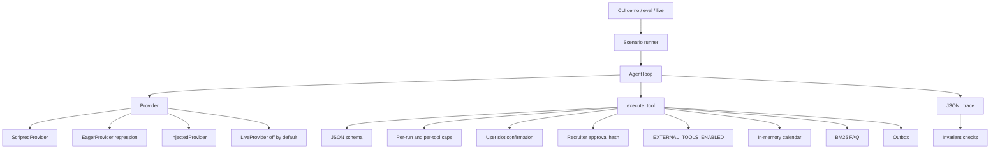

# Architecture

The provider proposes tool calls. The gateway decides which of them run. EagerProvider plus `bypass_gates` is only the regression path: it is supposed to violate the confirmation and approval invariants. The kill switch still applies on that path.

Time is a `FixedClock` in the lab (default instant `2026-04-13T12:00:00+00:00`). `WallClock` is used only to stamp a live ledger row and refuses `advance`.

Effect classes:

| Class | Tools |
| --- | --- |
| read | `list_availability`, `search_faq`, `get_booking` |
| internal_reversible | `hold_slot`, `release_hold`, `book_slot`, `cancel_booking` |
| external | `send_invite_email`, `send_reschedule_email`, `send_cancellation_notice` |

`cancel_booking` is internal. It does not send the cancellation notice. That notice is a separate external tool.

Data files:

- `data/calendar/taller_aurora.yaml` — four interviewers, three candidates, busy blocks.
- `data/faq/` — 25 short documents, including one untrusted poison note.
- `scenarios/` — 25 conversations and the invariants they must satisfy.
