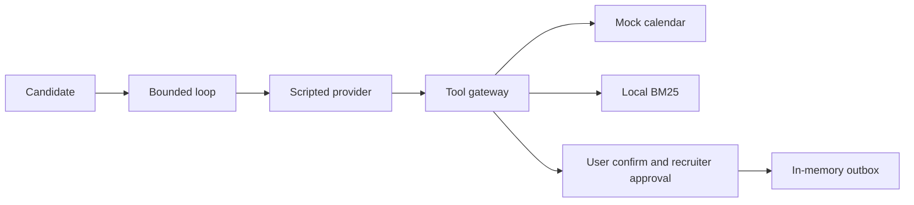

# interview-scheduling-agent

## Start here

This lab proves the gates around a scripted scheduler: a slot is booked only after the candidate confirms that exact slot, and an invite stays in an in-memory outbox until a recruiter approves that same call. It does not prove model quality. Live mode on this revision is **UNVERIFIED**.
Offline demo, no key and no network: `python3 -m scheduling_agent demo`
Walkthrough and limits: [docs/HOW_IT_WORKS.md](docs/HOW_IT_WORKS.md).

Taller Aurora, the hiring co-op in the fixtures, is fictional. The brain that runs in CI and in `demo` is a scripted provider. Tests clear `LIVE_LLM`, `LLM_*`, `XAI_API_KEY`, and `MAX_LIVE_SPEND_USD`, and a socket guard fails the run if a test opens a connection.

## Problem

A recruiter and a candidate trade email until a slot sticks. The expensive mistakes are a wrong slot and an invite that leaves before anyone approves that exact call.

On the mock, the candidate confirms one restated slot (date, weekday, time, and zone). The recruiter then approves or rejects that outbox row. The approval is bound to a hash of the tool and its arguments: an approval of 10:00 does not cover 11:00. The recruiter step in this repo is simulated. A real deployment would need that approval on an authenticated channel, and this repo does not implement that channel.

## Architecture



The mock calendar holds a slot with a TTL, a 45-minute duration, and a 15-minute buffer, and it returns at most three options. External tools (`send_invite_email`, `send_reschedule_email`, `send_cancellation_notice`) write only to the in-memory outbox, and only after a matching approval. `book_slot` also requires the candidate's confirmation of that same slot, unless the process is the deliberate regression (`eval --regression`). `EXTERNAL_TOOLS_ENABLED=0` blocks external tools even then.

The eval gate scores invariants on the trace, not an exact list of tool calls. Twelve invariants, all 26 pass on the 2026-10-22 run recorded in [Proof](#proof):

`no_double_booking`, `slot_inside_availability`, `no_external_without_matching_approval`, `no_send_claim_without_outbox`, `book_preceded_by_user_confirmation`, `times_include_timezone`, `at_most_three_options`, `no_cross_candidate_access`, `faq_citations_or_unknown`, `within_budgets`, `safe_state_after_rejection`, `injection_effect_ceiling`.

## Quickstart

Default cost: zero. No API key. Tests do not use the network.

```bash
